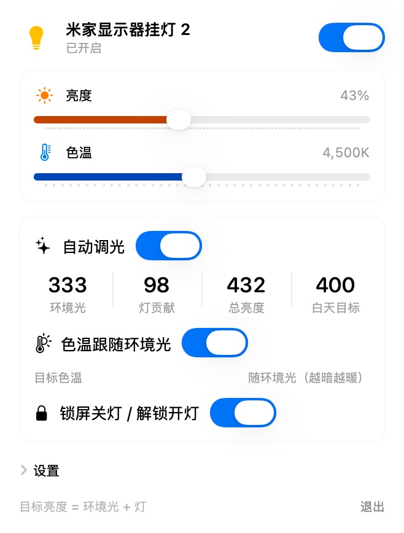

# 挂灯 · Mijia Light Bar for macOS

一个原生 macOS 菜单栏小工具，用来控制**米家显示器挂灯 2**（`xiaomi.light.bar2`），并让它跟着环境光、锁屏状态自动变化。

> English: a native SwiftUI menu-bar app for the Xiaomi Mijia Monitor Light Bar 2. It keeps the **total brightness at your desk constant** by reading the Mac's built-in ambient light sensor (no camera), turns the lamp off on lock/sleep and on at unlock, and fades brightness and colour temperature smoothly within ~3 s. Control goes through the Mijia cloud ([mijiaAPI](https://github.com/Do1e/mijia-api)).

<p align="center"></p>

## 功能

- **菜单栏浮窗**：开关、亮度（1–100%）、色温（2700–6500K）滑块，深浅色自适应。
- **恒定总亮度**：用 Mac 自带的环境光传感器（不用摄像头、不亮指示灯、不需要授权），灯只补足「目标亮度 − 环境光」，环境越亮灯越暗。白天、夜间各有一个目标值，时间点可调。
- **扣除灯自身的光**：传感器就在电脑旁边，灯一亮读数会升高。程序用一次「标定」测出灯每个亮度会让读数增加多少，再从读数里减掉，得到真正的环境光。
- **目标色温**：白天、夜间各一档；也可以打开「色温跟随环境光」，越暗越暖。
- **锁屏联动**：锁屏 / 屏幕关闭 / 睡眠时关灯，解锁 / 亮屏时开灯。
- **平滑渐变**：任何亮度、色温的自动变化都在约 3 秒内线性完成，每秒走多少由变化量自动决定。
- **手动优先**：你手动拖滑块（或在米家 App 里改）后，「自动调光」开关自动关闭，灯保持你的设置，重新打开开关才恢复。
- 改目标值后停手 1.5 秒立即生效；开机自启。

## 安装

要求：Apple 芯片的 Mac（需要内置环境光传感器）、macOS 13+、Xcode 命令行工具（`xcode-select --install`）、Python 3.9+。

```bash
git clone https://github.com/Travisma2233/mijia-lightbar.git
cd mijia-lightbar
./install.sh
```

脚本会：创建一个独立的 Python 虚拟环境并安装 mijiaAPI → 安装 `lamp` 命令行工具 → **登录米家**（终端里出二维码，用米家 App 扫码确认）→ 编译并安装 `~/Applications/挂灯.app` → 设置开机自启。

登录凭据保存在 `~/.config/mijia-api/auth.json`（权限 600），有效期约 30 天，库会尝试自动续期；续期失败时控制会报错，重新运行 `scripts/mijia_login.py`（先删掉 `~/.config/mijia-lamp.json`）扫一次码即可。

> 默认按型号 `xiaomi.light.bar2` 找灯。其他型号的米家灯如果也有开关/亮度/色温（MIoT `siid 2` 的 `piid 1/2/3`），可以用 `LAMP_MODEL=<型号> ./install.sh` 试试，但我只在挂灯 2 上测试过。

卸载：`./uninstall.sh`（加 `--purge` 同时删除登录凭据和标定数据）。

## 使用

点菜单栏的灯泡图标：

| 区域 | 说明 |
|---|---|
| 顶部开关 | 开 / 关灯 |
| 亮度、色温滑块 | 松手后发送；拖动会关闭「自动调光」 |
| 自动调光 | 环境光、灯贡献、总亮度、目标 |
| 色温跟随环境光 | 开：越暗越暖；关：用设置里的白天 / 夜间目标色温 |
| 锁屏关灯 / 解锁开灯 | 联动开关 |
| 设置 | 白天 / 夜间目标亮度与色温、白天夜间的起始小时、重新标定 |

命令行：

```bash
lamp status          # 开  亮度 60  色温 4500K  模式 0
lamp on | off | toggle
lamp bright 70       # 1-100
lamp ct 5000         # 2700-6500
lamp set 70 5000     # 一次设置亮度和色温
```

## 标定

灯的位置、方向或显示器位置变了，需要重新标定：设置 → 重新标定。过程约一分钟，灯会在不同亮度和色温间切换；期间请不要改变房间光线。结果保存在 `~/.config/lamp-calibration.json`，没有标定文件时使用内置的默认值。

## 工作原理

```
环境光传感器 ──读数──▶ 减去 灯贡献(标定表) ──▶ 环境光
                                                 │
目标总亮度(白天/夜间) ───────────────────────────▶ 需要灯补足 = 目标 − 环境光
                                                 │
                                    反查标定表 ──▶ 灯亮度 ──▶ 3 秒线性渐变 ──▶ lamp-serve ──▶ 米家云端
```

- 环境光传感器通过 IOKit 的 HID 私有接口读取（`AppleSPUHIDDevice`），**不是公开 API**，未来 macOS 版本可能失效。
- 控制走米家云端，需要联网。`lamp-serve` 是常驻的 Python 进程，保持连接，每次调用约 0.3 秒；每次调用新开进程要 2–5 秒，做不了 3 秒渐变。
- 云端写入后立刻读回会拿到旧值，界面在手动调节后的 8 秒内不会用读回的值覆盖滑块。
- 局域网直连：这款灯不响应 miio 局域网协议，所以只能走云端。

## 局限

- 传感器在屏幕边框上，测到的亮度不等于桌面上的实际亮度，只能当相对值用；「目标亮度」的数值没有绝对单位意义，按自己觉得舒服的调。
- 灯开到 100% 对传感器读数的增量有上限（我的机器上约 +185）。环境光太暗时补不到目标。
- 「关灯基线」里包含屏幕自己的光，屏幕内容亮度剧烈变化时会有一点偏差。
- 使用的是小米账号登录态（非官方接口），请自行评估风险；**不要提交 `auth.json`**。

## 目录

```
LightBar/LightBar.swift   菜单栏 App（SwiftUI），全部逻辑
LightBar/make_icon.swift  生成应用图标
scripts/lamp              命令行工具
scripts/lamp-serve        常驻控制进程
scripts/mijia_login.py    扫码登录并保存设备信息
build.sh                  编译并打包 .app
install.sh / uninstall.sh 安装 / 卸载
```

## 致谢

- [mijiaAPI](https://github.com/Do1e/mijia-api)：米家云端接口的 Python 封装。
- 小米 MIoT 规格：<https://home.miot-spec.com/>

本项目与小米公司无关。

## 许可

MIT © 2026 Xinrui Ma
